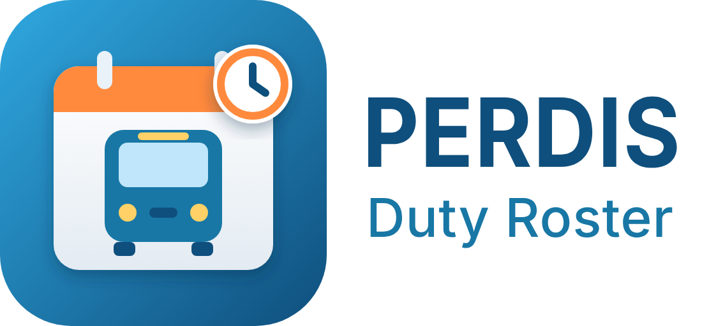
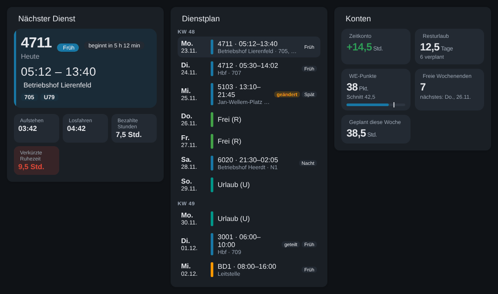

<h1 align="center">
  <picture>
    <source media="(prefers-color-scheme: dark)" srcset="https://raw.githubusercontent.com/seb5594/hass-perdis_roster-integration/main/custom_components/perdis_roster/brand/dark_logo@2x.png">
    
  </picture>
</h1>

[🇬🇧 English](README.md) · **🇩🇪 Deutsch**

Dein Dienstplan aus **MOBILE-PERDIS** in Home Assistant: der nächste Dienst mit Countdown, die
Weckzeit, die Ruhezeit bis zum nächsten Dienst, freie Wochenenden, Zeitkonto, Resturlaub und
WE-Punkte. Änderungen am Dienstplan kommen als Benachrichtigung, und Automationen reagieren auf
den Moment, in dem du aufstehen musst oder dein Dienst beginnt.

PERDIS ist das Personaldispositionssystem, das viele Bus- und Straßenbahnbetriebe in Deutschland,
Österreich und den Niederlanden nutzen. Fahrerinnen und Fahrer sehen ihren Dienstplan im
**WebComm**-Portal im Browser oder in der **AppComm**-App. Diese Integration meldet sich mit deinem
persönlichen Konto am selben Portal an.

> [!IMPORTANT]
> ⚠️ **Dies ist eine inoffizielle Integration.** PERDIS ist ein Produkt der INIT Mobility Software
> Solutions GmbH, die die Schnittstellen von WebComm und AppComm nicht dokumentiert. Die
> Integration liest, was dir das Portal nach der Anmeldung zeigt – genau wie dein Browser. Sie steht
> in keiner Verbindung zu INIT oder einem Verkehrsunternehmen und wird von diesen weder
> unterstützt noch empfohlen. Ein Update des Portals kann die Seiten ändern; wenn etwas nicht mehr
> funktioniert, [melde es bitte](https://github.com/seb5594/hass-perdis_roster-integration/issues).

<p align="center">
  
</p>

## 📑 Inhalt

- [✨ Funktionen](#-funktionen)
- [🚌 Verkehrsunternehmen](#-verkehrsunternehmen)
- [📋 Voraussetzungen](#-voraussetzungen)
- [📦 Installation](#-installation)
- [⚙️ Einrichtung](#️-einrichtung)
- [🎛️ Optionen](#️-optionen)
- [📊 Entitäten](#-entitäten)
- [🃏 Dashboard-Karten](#-dashboard-karten)
- [⚡ Automationen](#-automationen)
- [🛠️ Aktionen](#️-aktionen)
- [📱 AppComm (Perdis mobil)](#-appcomm-perdis-mobil)
- [🧠 So funktioniert es](#-so-funktioniert-es)
- [🔒 Datenschutz](#-datenschutz)
- [🩺 Fehlersuche](#-fehlersuche)
- [🤝 Mitmachen](#-mitmachen)

## ✨ Funktionen

- 🚌 **Unternehmen aus einer Liste wählen.** Der Einrichtungsdialog kennt die Portal-Adresse
  mehrerer Verkehrsunternehmen. Andere gibst du selbst ein; jede Adresse aus dem Browser funktioniert.
- 🕐 **Nächster Dienst auf einen Blick**: Dienstnummer, Beginn und Ende, Meldeort, Linien, Countdown
  und ob es ein Früh-, Mittel-, Spät-, Nacht- oder geteilter Dienst ist.
- ⏰ **Abgeleitete Zeiten**: wann du aufstehen und wann du losfahren musst, berechnet aus deiner
  Vorlaufzeit und deinem Arbeitsweg.
- 😴 **Ruhezeit-Prüfung**: die Ruhezeit zwischen zwei Diensten, mit Warnung, wenn sie kürzer als
  dein Minimum ist (Standard 11 Stunden, wie in der EU-Verordnung 561/2006).
- 📅 **Die nächsten Tage**: heute und morgen, der nächste freie Tag, Arbeitstage am Stück, das
  nächste freie Wochenende und wie viele freie Wochenenden der Plan enthält.
- ⏱️ **Geplante Stunden** der laufenden Woche und des Monats, gezählt nach Dienstart.
- 💼 **Konten**: Zeitkonto, Soll- und Istzeit, Resturlaub (auch nach dem verplanten Urlaub),
  WE-Punkte und der Abstand zum Durchschnitt deiner Gruppe.
- 🔔 **Dienstplanänderungen** werden bei jeder Abfrage erkannt und als Benachrichtigung, als Ereignis
  und in einem Sensor mit Liste gemeldet.
- ⚡ **Geräte-Auslöser** für den Automations-Editor: *Zeit zum Aufstehen*, *Zeit zum Losfahren*,
  *Dienst hat begonnen*, *Dienst ist zu Ende*, *freies Wochenende hat begonnen*, *Dienstplan hat
  sich geändert* – sekundengenau.
- 🗓️ **Kalender** mit jedem Dienst und freien Tag, für das Kalender-Dashboard und Kalender-Auslöser.
- 🃏 **Drei Dashboard-Karten**, die sich selbst registrieren: nächster Dienst, Dienstplan und Konten.
- 💾 **Übersteht Wartungsfenster**: der letzte Dienstplan wird zwischengespeichert und bleibt
  verfügbar, während das Portal nicht erreichbar ist.
- 🌍 **Deutsch und Englisch** durchgehend: Einrichtung, Entitäten, Karten, Benachrichtigungen, Kalender. Einrichtung und Entitätsnamen gibt es zusätzlich auf **Niederländisch**; andere Sprachen fallen auf Englisch zurück.
- 🪶 **Sparsam**: keine zusätzlichen Python-Pakete, eine Portal-Abfrage alle 30 Minuten, und der
  Zwischenspeicher wird nur geschrieben, wenn sich der Dienstplan wirklich geändert hat.

## 🚌 Verkehrsunternehmen

Diese Unternehmen betreiben ein öffentliches PERDIS-WebComm-Portal. Jede Adresse wurde im November
2026 durch Aufrufen der Anmeldeseite geprüft.

| Unternehmen | Region | Portal |
| --- | --- | --- |
| BOGESTRA | Bochum / Gelsenkirchen 🇩🇪 | `https://webcomm.bogestra.de/WebComm/` |
| DVG Duisburger Verkehrsgesellschaft | Duisburg 🇩🇪 | `https://perdis.dvv.de/WebComm/` |
| RegioBus Hannover | Region Hannover 🇩🇪 | `https://perdis.regiobus.de/WebComm/` |
| Rheinbahn | Düsseldorf 🇩🇪 | `https://webcom.rheinbahn.de/WebComm/` |
| rnv Rhein-Neckar-Verkehr | Mannheim / Heidelberg / Ludwigshafen 🇩🇪 | `https://fahrerauskunft.rnv-online.de/WebComm/` |
| Salzburg AG Verkehr | Salzburg 🇦🇹 | `https://perdis.salzburg-ag.at/WebComm/` |
| Transdev / Connexxion | Niederlande 🇳🇱 | `https://diensten1.transdev.nl/WebComm/` |
| ÜSTRA Hannoversche Verkehrsbetriebe | Hannover 🇩🇪 | `https://wbc.uestra.de/WebComm/` |
| VGF Verkehrsgesellschaft Frankfurt | Frankfurt am Main 🇩🇪 | `https://perdis-info.vgf-ffm.de/WebComm/` |
| WSW mobil | Wuppertal 🇩🇪 | `https://service.wsw-online.de/WebComm/` ¹ |

¹ Das Portal meldete am Prüftag „vorübergehend nicht verfügbar“.

🔎 **Dein Unternehmen fehlt?** Wähle *Portal-Adresse selbst eingeben* und füge die Adresse ein, die
du im Browser öffnest. Der reine Hostname wie `perdis.example.org` reicht auch; `/WebComm/` ergänzt
die Integration selbst. Wenn es klappt, [sag gern Bescheid](https://github.com/seb5594/hass-perdis_roster-integration/issues),
dann kommt das Unternehmen in die Liste.

## 📋 Voraussetzungen

- 🏠 Home Assistant **2025.1** oder neuer.
- 👤 Dein eigenes Konto für das WebComm-Portal deines Unternehmens (Benutzerkennung bzw.
  Personalnummer und Kennwort) – dasselbe wie im Browser.
- 🌐 Home Assistant muss das Portal erreichen können. Manche Unternehmen erlauben den Zugriff nur aus
  dem eigenen Netz; dann kommt auch die Integration nicht hin.

## 📦 Installation

### HACS / Marketplace (empfohlen)

1. Klicke oben auf den Button **HACS · Marketplace** oder öffne **HACS** (Home Assistant 2026.10
   und älter) bzw. **Einstellungen → Marketplace** (ab 2026.11) und suche nach **Perdis Duty
   Roster**. Wird es nicht gefunden, füge zuerst
   `https://github.com/seb5594/hass-perdis_roster-integration` als benutzerdefiniertes Repository der
   Kategorie *Integration* hinzu.
2. Herunterladen und Home Assistant neu starten.

### Manuell

1. Lade `perdis.zip` aus dem [neuesten Release](https://github.com/seb5594/hass-perdis_roster-integration/releases/latest).
2. Entpacke es nach `config/custom_components/perdis_roster/`, sodass `manifest.json` in diesem Ordner liegt.
3. Home Assistant neu starten.

## ⚙️ Einrichtung

1. **Einstellungen → Geräte & Dienste → Integration hinzufügen** und nach **Perdis Duty Roster**
   suchen.
2. Wähle, wie dein Portal gefunden wird:
   - 🚌 **Mein Verkehrsunternehmen aus der Liste wählen** oder
   - ✍️ **Portal-Adresse selbst eingeben** – die Adresse aus dem Browser einfügen. *Art des Portals*
     bleibt auf **WebComm**, außer dein Unternehmen hat dir eine AppComm-Dienstadresse genannt.
3. **Benutzerkennung / Personalnummer** und **Kennwort** eingeben. Der Dialog meldet sich einmal zur
   Prüfung an; wenige Sekunden später ist der Dienstplan da.

Das Konto wird nach deiner Personalnummer und deinem Nachnamen benannt, z. B. **12345 -
Mustermann** (den Nachnamen liest die Integration aus dem Portal-Header); zeigt das Portal keinen
Namen, wird nur die Personalnummer verwendet.

Mehrere Konten (zum Beispiel von einem Paar, das beide fahren) lassen sich nebeneinander anlegen;
jedes bekommt ein eigenes Gerät mit eigenen Entitäten.

Änderst du dein Kennwort im Portal, zeigt Home Assistant einen **Reparaturhinweis** und fragt nach
dem neuen – die Integration muss nicht entfernt werden.

## 🎛️ Optionen

**Einstellungen → Geräte & Dienste → Perdis Duty Roster → Konfigurieren**

| Option | Standard | Wirkung |
| --- | --- | --- |
| ⏰ Aufstehen vor Dienstbeginn | 90 min | Ergibt die Weckzeit und ihren Auslöser |
| 🚗 Arbeitsweg | 30 min | Ergibt die Losfahrzeit und ihren Auslöser |
| 😴 Mindestruhezeit zwischen Diensten | 11 h | Eine kürzere Ruhezeit schaltet *Verkürzte Ruhezeit* ein |
| 🔔 Bei Dienstplanänderungen benachrichtigen | an | Zeigt eine Benachrichtigung je Änderung |
| 🔄 Portal abfragen alle | 30 min | Wie oft das Portal gefragt wird (10–360 min) |
| ➡️ Tage voraus | 42 | Wie weit der Dienstplan im Voraus gelesen wird |
| ⬅️ Vergangene Tage behalten | 7 | Vergangene Tage, die im Kalender bleiben |
| 🕐 Genaue Dienstzeiten für so viele Tage voraus laden | 10 | Auf Portalen, die je Tag nur eine Dienstnummer zeigen, liefert die Detailseite jedes Dienstes seine echten Zeiten, Orte und Linien. Eine zusätzliche Anfrage je Arbeitstag; 0 schaltet es ab |
| 👤 Mitarbeiter (Person) | – | Eine Person-Entität, zu der der Dienstplan gehört; wird an deine Benachrichtigung/dein Skript übergeben |
| 🔔 Aktion bei Dienstplanänderungen | – | Der volle Aktionen-Editor von Home Assistant: Dienst wählen (ein `notify.…` oder `script.…`) und Felder ausfüllen oder eine Sequenz bauen. Mit `{{ title }}` und `{{ message }}` übergibst du, was die Benachrichtigung anzeigt; außerdem verfügbar: `{{ changes }}`, `{{ person }}`, `{{ entry_id }}` |
| 📅 Kalender: ein Eintrag je Dienstabschnitt | an | Teilt jeden Dienst in einen Kalendereintrag je Abschnitt (eine Fahrt mit Linie und Kurs, eine Pause als Pause); aus behält einen Eintrag mit den Abschnitten im Text |

> [!TIP]
> Zeigt die Monatsansicht deines Portals nur die Dienstnummer (keine Zeiten), stammen Beginn, Ende,
> Meldeorte und Linien von der Detailseite jedes Dienstes und erscheinen am nächsten Dienst und im
> Kalender. Mit der Option *Genaue Dienstzeiten laden* steuerst du, wie weit im Voraus das geschieht.

Der eingeklappte Bereich **Seiten des Portals (für Fortgeschrittene)** wird nur bei ungewöhnlichen
Portalen gebraucht. Die Integration findet Dienstplan, Konten und WE-Punkte selbst im Menü des
Portals; wird eine Seite nicht gefunden (siehe [Fehlersuche](#-fehlersuche)), trage hier ihren Pfad
ein, z. B. `Dienstplan.aspx`.

## 📊 Entitäten

> [!NOTE]
> Es werden nur die Sensoren angelegt, die dein Portal tatsächlich füllen kann. Bei der Einrichtung
> prüft die Integration, welche Seiten dein Portal ausliefert und welche Kontowerte es zurückgibt;
> ein Portal ohne WE-Punkte zeigt dann keine WE-Punkte-Sensoren statt einer Reihe „Unbekannt".
> Nach dem Freischalten einer neuen Funktion die Integration neu laden.

Alle Entitäten gehören zu einem Gerät pro Konto. Die Entitäts-IDs unten gehen von einem Konto
namens *Rheinbahn (4711)* aus; deine beginnen mit dem Namen deines Kontos. Mit Home Assistant auf
Deutsch heißen die Entitäten so, wie in der Spalte *Name* angegeben.

### 🕐 Nächster Dienst

| Name | Beispiel | Hinweis |
| --- | --- | --- |
| Nächster Dienst | `4711` | Laufender oder nächster Dienst. Attribute: Datum, Beginn, Ende, Orte, Linien, Stunden, Dienstart, Minuten bis Beginn/Ende, Weck- und Losfahrzeit, Ruhezeit davor |
| Nächster Dienstbeginn / Nächstes Dienstende | Zeitstempel | Als relative Zeit anzeigbar („in 5 Stunden“) |
| Nächster Dienstantrittsort | `Betriebshof Musterstadt` | Meldeort |
| Art des nächsten Dienstes | `Frühdienst` | Früh-, Mittel-, Spät-, Nacht- oder geteilter Dienst |
| Weckzeit | Zeitstempel | Dienstbeginn minus Vorlaufzeit |
| Losfahren | Zeitstempel | Dienstbeginn minus Arbeitsweg |
| Ruhezeit vor nächstem Dienst | `1 Tag 3 Stunden 20 Minuten` | Ende des vorigen bis Beginn des nächsten Dienstes, in Tagen, Stunden und Minuten (die Stunden stehen im Attribut `hours`) |

### 📅 Tage

| Name | Beispiel | Hinweis |
| --- | --- | --- |
| Heute / Morgen | `Dienst` | Dienst, Bereitschaft, Schulung, Frei, Urlaub, Freizeitausgleich, Krank |
| Nächster freier Tag | `26.11.2026` | Heute, wenn du frei hast |
| Tage bis frei | `3 d` | |
| Arbeitstage am Stück | `3 d` | Von heute bis zum nächsten freien Tag |
| Nächstes freies Wochenende | `28.11.2026` | Samstag des nächsten Wochenendes mit zwei freien Tagen |
| Freie Wochenenden voraus | `2` | Freie Wochenenden im sichtbaren Dienstplan |
| Geplante Stunden diese Woche / diesen Monat | `38,5 h` | Attribute zählen die Dienste nach Art und Dienstlage |

### 💼 Konten

| Name | Beispiel | Hinweis |
| --- | --- | --- |
| Zeitkonto | `14,5 h` | Attribute: Soll- und Iststunden, alle Salden, die das Portal zeigt |
| Tageskonto heute | `-0,5 h` | Der heutige Tag der Tageswerte-Seite; Attribute: Soll-, Ist- und laufende Kontostunden sowie die letzten zehn Tage |
| Resturlaub | `12,5 d` | Attribute: verplante Tage, Anspruch, Rest nach dem verplanten Urlaub |
| WE-Punkte | `38,5 pts` | Attribute: Gruppendurchschnitt, letzte Einträge |
| WE-Punkte zum Durchschnitt | `-3,5 pts` | Negativ: weniger Punkte als deine Gruppe |
| Freie Wochenenden dieses Jahr | `7` | Wie vom Portal gezählt |

### 🔎 Ja / Nein

| Name | An, wenn |
| --- | --- |
| Im Dienst | ein Dienst läuft |
| Heute frei / Morgen frei | der Tag frei, Urlaub oder Freizeitausgleich ist |
| Heute geteilter Dienst | der heutige Dienst eine lange Pause hat |
| Verkürzte Ruhezeit | die Ruhezeit vor dem nächsten Dienst unter deinem Minimum liegt |
| Portal | die letzte Abfrage das Portal erreicht hat (Diagnose) |

### 🗂️ Listen und Kalender

| Name | Hinweis |
| --- | --- |
| Dienstplan | Anzahl der Tage in den nächsten sechs Wochen; das Attribut `days` versorgt die Dienstplan-Karte |
| Dienstplanänderungen | Änderungen der letzten 14 Tage, jeweils mit lesbarer Zusammenfassung |
| Letzte Aktualisierung | Letzte erfolgreiche Abfrage, letzter Fehler und gefundene Seiten (Diagnose) |
| Dienstplan-Rekorde | Längster Dienst, frühester Beginn und spätestes Ende im geladenen Dienstplan (Diagnose) |
| Dienste mit Details | Wie viele der kommenden Dienste ihre Abschnitte im Detail haben (Diagnose) |
| Schaltfläche *Dienstplan aktualisieren* | Fragt das Portal sofort ab; entspricht der Aktion `perdis_roster.refresh` |
| Kalender *Dienste* | Dienste als Termine mit Uhrzeit, freie Tage und Abwesenheiten ganztägig |

Lange Listen werden nicht in die Recorder-Datenbank geschrieben, damit der Verlauf klein bleibt.

## 🃏 Dashboard-Karten

Die Karten gehören zur Integration und registrieren sich selbst – **keine Ressource nötig**.
Dashboard bearbeiten, **Karte hinzufügen** und nach **Perdis** suchen. Jede Karte hat einen
**visuellen Editor** mit Abschnitten (*Inhalt*, *Darstellung*, *Verhalten*) – du musst kein YAML
schreiben. Ohne Einstellungen zeigt eine Karte das erste Perdis-Konto.

> **Karten nicht in der Auswahl?** Sie werden als Frontend-Modul geladen und erscheinen deshalb
> **nicht** unter *Einstellungen → Dashboards → Ressourcen* – diese Liste ist nur für von Hand
> hinzugefügte Ressourcen. Nach dem Installieren oder Aktualisieren den **Browser mit geleertem
> Cache neu laden** (Strg/Cmd + Umschalt + R), denn Home Assistant und der Browser cachen
> Frontend-Module. Immer noch nichts? Die Integration unter *Einstellungen → Geräte & Dienste*
> neu laden, im Log auf die Zeile `Perdis dashboard cards served from …` achten und – nur als
> letzten Ausweg – die Ressource von Hand hinzufügen unter *Einstellungen → Dashboards →
> Ressourcen*: URL `/perdis_roster_static/perdis-cards.js`, Typ *JavaScript-Modul*.

| Karte | Zeigt |
| --- | --- |
| 🧩 `perdis-card` | **Alles-in-einem**: eine Reiterleiste über den folgenden Karten (Nächster Dienst, Dienstdetails, Dienstplan, Konten, Kalender, Tausch). Reiter im Editor ein-/ausschalten und sortieren. Die Kopfzeile zeigt deinen Betrieb als Badge; mit `logo` (z. B. `/local/logo.png`) zeigst du stattdessen dein eigenes Bild |
| 🕐 `perdis-shift-card` | Den nächsten Dienst: Nummer, Dienstart, Countdown, Zeiten, Meldeort, Linien, Weck- und Losfahrzeit, Ruhezeit-Warnung, Fortschritt während des Dienstes |
| 📋 `perdis-roster-card` | Die nächsten Tage nach Kalenderwoche, farbig nach Art, geänderte Tage markiert |
| 💼 `perdis-accounts-card` | Zeitkonto, Resturlaub, WE-Punkte im Vergleich zum Schnitt, freie Wochenenden und die geplanten Stunden der Woche oder des Monats |
| 🧾 `perdis-shift-detail-card` | Den nächsten Dienst Abschnitt für Abschnitt als echte Tabelle: Meldeort, Zeit, Linie, Kurs und Ablöserichtung, Pausen klar ausgewiesen |

Alles lässt sich im Editor (oder in YAML) anpassen. Optionen für alle Karten:

| Option | Standard | Wirkung |
| --- | --- | --- |
| `device_id` | erstes Konto | Welches Perdis-Konto die Karte zeigt |
| `title` | Kartenname | Eigener Titel in der Kopfzeile |
| `icon` | `mdi:bus-clock` | Eigenes Symbol in der Kopfzeile |
| `show_header` | `true` | Kopfzeile ausblenden für eine schlichte Karte |
| `accent` | nach Dienstart | Akzentfarbe (RGB), überschreibt die Typfarbe |
| `tap_action` | more-info | Volle Lovelace-Aktion (`more-info`, `navigate`, `url`, `perform-action`, `none`) |

<details>
<summary>🕐 Optionen der Dienst-Karte</summary>

| Option | Standard | Wirkung |
| --- | --- | --- |
| `show_facts` | alle | Welche Eckdaten: `wake_up`, `leave_home`, `duration`, `paid`, `breaks`, `rest` |
| `show_location` | `true` | Meldeort anzeigen |
| `show_lines` | `true` | Linien-Badges anzeigen |
| `show_countdown` | `true` | Countdown-Pille anzeigen |
| `show_progress` | `true` | Fortschrittsbalken während des Dienstes |

```yaml
type: custom:perdis-shift-card
accent: [123, 97, 255]
show_facts: [wake_up, rest]
show_lines: false
```

</details>

<details>
<summary>📋 Optionen der Dienstplan-Karte</summary>

| Option | Standard | Wirkung |
| --- | --- | --- |
| `days` | `14` | Wie viele Tage (3–42) |
| `hide_types` | – | Tagesarten ausblenden, z. B. `[free, vacation]` |
| `show_days_off` | `true` | Abkürzung: `false` blendet Frei, Urlaub und Ausgleich aus |
| `group_by_week` | `true` | Tage unter Kalenderwochen-Überschriften gruppieren |
| `compact` | `false` | Enge Zeilen ohne zweite Zeile |
| `show_location` / `show_lines` / `show_tags` | `true` | Meldeort, Linien, Markierungen anzeigen |
| `highlight_today` | `true` | Heutige Zeile hervorheben |

```yaml
type: custom:perdis-roster-card
days: 21
hide_types: [free, vacation, compensation]
compact: true
group_by_week: false
```

</details>

<details>
<summary>💼 Optionen der Konten-Karte</summary>

| Option | Standard | Wirkung |
| --- | --- | --- |
| `show_tiles` | 5 Kacheln | Welche Kacheln und in welcher Reihenfolge: `overtime`, `vacation`, `weekend_points`, `free_weekends`, `planned_week`, `planned_month` |
| `columns` | `0` (auto) | Feste Spaltenzahl (1–4) |

```yaml
type: custom:perdis-accounts-card
show_tiles: [overtime, weekend_points, planned_month]
columns: 3
device_id: 0123456789abcdef0123456789abcdef  # optional, für ein zweites Konto
```

</details>

## ⚡ Automationen

### Geräte-Auslöser

Im Automations-Editor **Gerät → dein Perdis-Konto** wählen. Die Auslöser kommen sekundengenau,
ohne Abfrageschleife:

| Auslöser | Wann |
| --- | --- |
| ⏰ Zeit zum Aufstehen | Dienstbeginn minus Vorlaufzeit |
| 🚗 Zeit zum Losfahren | Dienstbeginn minus Arbeitsweg |
| ▶️ Dienst hat begonnen / ⏹️ Dienst ist zu Ende | Zu Beginn und Ende jedes Dienstes |
| 🎉 Freies Wochenende hat begonnen | Samstag 00:00 eines Wochenendes mit zwei freien Tagen |
| 🔔 Dienstplan hat sich geändert | Wenn eine Abfrage eine Änderung findet |

### Ereignisse

Jeder Moment ist auch ein Ereignis auf dem Bus, `perdis_roster_event`, mit `type` (`wake_up`,
`leave_home`, `shift_started`, `shift_ended`, `free_weekend_started`, `schedule_changed`),
`device_id`, `entry_id` und dem `duty`. Bei Änderungen kommen `changes` und eine lesbare `summary`
dazu.

<details>
<summary>📱 Push-Nachricht bei Dienstplanänderung</summary>

```yaml
alias: Dienstplanänderungen melden
triggers:
  - trigger: event
    event_type: perdis_roster_event
    event_data:
      type: schedule_changed
actions:
  - action: notify.mobile_app_mein_handy
    data:
      title: Dienstplan geändert
      message: "{{ trigger.event.data.summary | join('\n') }}"
```

</details>

<details>
<summary>⏰ Lichtwecker 10 Minuten vor der Weckzeit, nur bei Frühdienst</summary>

```yaml
alias: Lichtwecker vor dem Frühdienst
triggers:
  - trigger: template
    value_template: >
      {{ states('sensor.rheinbahn_4711_weckzeit') not in ['unknown', 'unavailable']
         and now() >= states('sensor.rheinbahn_4711_weckzeit') | as_datetime - timedelta(minutes=10) }}
conditions:
  - condition: state
    entity_id: sensor.rheinbahn_4711_art_des_nachsten_dienstes
    state: early
actions:
  - action: light.turn_on
    target:
      entity_id: light.schlafzimmer
    data:
      brightness_pct: 30
      transition: 600
```

</details>

<details>
<summary>🌡️ Wohnung vor Dienstende aufheizen</summary>

```yaml
alias: Warme Wohnung nach dem Dienst
triggers:
  - trigger: template
    value_template: >
      {{ is_state('binary_sensor.rheinbahn_4711_im_dienst', 'on')
         and now() >= states('sensor.rheinbahn_4711_nachstes_dienstende') | as_datetime - timedelta(minutes=45) }}
actions:
  - action: climate.set_preset_mode
    target:
      entity_id: climate.wohnzimmer
    data:
      preset_mode: comfort
```

</details>

## 🛠️ Aktionen

| Aktion | Wirkung |
| --- | --- |
| `perdis_roster.refresh` | Fragt das Portal sofort ab, statt auf die nächste Abfrage zu warten. Optional `config_entry_id` |
| `perdis_roster.get_duties` | Liefert die Dienste zwischen `start_date` und `end_date` (Standard: zwei Wochen ab heute) samt geplanter Stunden – für Skripte und Benachrichtigungen |

```yaml
action: perdis_roster.get_duties
data:
  start_date: "2026-11-23"
  end_date: "2026-11-29"
response_variable: dienstplan
```

### 🔄 Diensttausch

Bei Portalen mit Diensttausch listet der Sensor **Offene Diensttausche** die offenen Angebote und den
Zeitraum für neue Wünsche, und die Dashboard-Karte **Perdis: Diensttausch** zeigt sie übersichtlich.
Vorerst nur zur Anzeige; das Eintragen und Beantworten von Tauschen aus Home Assistant folgt, sobald
es gegen ein echtes Portal vollständig getestet ist. Portale ohne Tausch-Seite bekommen Sensor und
Karte gar nicht erst.

## 📱 AppComm (Perdis mobil)

Neben WebComm gibt es die App **AppComm**. Dahinter läuft ein JSON-Dienst, den jedes Unternehmen
selbst freischalten muss; INIT veröffentlicht seine Schnittstelle nicht. Die Integration behandelt
AppComm deshalb als **experimentell**:

- *Portal-Adresse selbst eingeben* und **AppComm-Dienst (experimentell)** wählen.
- Der Client meldet sich per JSON an und nutzt ein Token (als `Authorization: Bearer`) oder ein
  Sitzungs-Cookie.
- Die Pfade sind standardmäßig `api/auth/login`, `api/roster`, `api/accounts` und
  `api/weekend-points`. Nutzt der Dienst deines Unternehmens andere, trage sie unter
  **Konfigurieren → Seiten des Portals (für Fortgeschrittene)** ein.
- Die Antworten werden flexibel gelesen: Die Liste der Tage wird überall in der Antwort gesucht,
  und die üblichen Feldnamen (`date`/`datum`, `start`/`beginn`, `dutyNumber`/`dienstNr`, …) werden
  verstanden.

Kennst du die echten Endpunkte eines AppComm-Dienstes, hilft ein
[Issue](https://github.com/seb5594/hass-perdis_roster-integration/issues) mit den Pfaden (niemals mit
Kennwort oder Token) allen weiter.

## 🧠 So funktioniert es

```text
 WebComm-Portal ──► Client ──► Parser ──► Momentaufnahme ──► Zwischenspeicher (.storage)
   (ASP.NET)        Anmeldung,  Tabellen    Dienste,              │
                    Seiten      nach        Konten,               ▼
                    finden,     Spalten-    WE-Punkte      Änderungserkennung ──► Benachrichtigung, Ereignis
                    Folgemonat  namen                             │
                                       jede Minute ◄──────────────┴──► Auswertung ──► Sensoren, Karten
                                       (ohne Netzwerk)                    Timer ──► Geräte-Auslöser
```

- **Anmeldung** wie im Browser: Der Client folgt der Cookie-Prüfung von ASP.NET, füllt das
  Anmeldeformular samt verstecktem View-State und behält das Sitzungs-Cookie. Eine abgelaufene
  Sitzung wird automatisch erneuert.
- **Seiten finden**: Die Menüs unterscheiden sich je Unternehmen, daher werden Dienstplan, Konten
  und WE-Punkte über die Wörter in den Menü-Links gefunden (Deutsch, Englisch, Niederländisch).
- **Tabellen lesen**: Spalten werden an ihrer Überschrift erkannt („Beginn“, „Dienstbeginn“,
  „Aanvang“, …), nicht an ihrer Position. Tabellen ohne Überschrift werden nach Inhalt gelesen.
  Zeiten nach Mitternacht wie `25:45` und geteilte Dienste werden berücksichtigt.
- **Folgemonat**: Endet die Dienstplanseite vor dem gewünschten Zeitraum, klickt der Client auf
  „weiter“ (bis zu dreimal).
- **Auswertungen** entstehen einmal pro Minute aus dem Zwischenspeicher, ganz ohne Netzwerkverkehr.
- **Momente** (Aufstehen, Dienstbeginn, …) sind Timer, die nach jeder Abfrage gesetzt werden –
  Automationen lösen dadurch auf die Sekunde aus.

## 🔒 Datenschutz

- 🔑 Benutzerkennung und Kennwort liegen im Konfigurationseintrag von Home Assistant und werden nur
  an die gewählte Portal-Adresse geschickt.
- 🏠 Der Dienstplan bleibt in deinem Home Assistant; nichts wird anderswohin gesendet.
- 🧾 Der Diagnose-Download lässt Benutzerkennung, Kennwort, deinen Namen und die Kontenbezeichnungen weg.

## 🩺 Fehlersuche

| Problem | Lösung |
| --- | --- |
| *Das Portal hat Benutzerkennung oder Kennwort nicht akzeptiert* | Im Browser mit denselben Daten anmelden. Manche Unternehmen sperren das Konto nach mehreren Fehlversuchen. |
| *Das Portal ist nicht erreichbar* | Die Adresse in einem Browser im selben Netz wie Home Assistant öffnen. Manche Portale sind nur im Firmennetz erreichbar. |
| *Nicht wie ein Perdis-Portal* | Adresse prüfen; sie muss auf den Ordner des Portals enden (z. B. `/WebComm/`). |
| Dienstplan bleibt leer | In **Letzte Aktualisierung** (Diagnose) das Attribut `pages` ansehen. Fehlt `roster`, den Pfad der Dienstplanseite in den erweiterten Optionen eintragen. |
| Konten oder WE-Punkte sind unbekannt | Nicht jedes Unternehmen zeigt sie. Stehen sie im Portal unter anderem Namen, bitte ein Issue mit dem Bezeichnungstext öffnen. |

Für ein Issue die **Diagnose** herunterladen (Geräteseite → ⋮ → *Diagnose herunterladen*). Mehr
Details liefert das Debug-Protokoll:

```yaml
logger:
  logs:
    custom_components.perdis_roster: debug
```

## 🤝 Mitmachen

- 🚌 **Ein Unternehmen fehlt?** Issue mit Name und Portal-Adresse öffnen.
- 🧩 **Eine Seite wird nicht verstanden?** Im Browser speichern (*Seite speichern unter… → nur
  HTML*), Name, Personalnummer und alles Persönliche durch Platzhalter ersetzen und an ein Issue
  hängen. Die Parser werden mit solchen Seiten in `.github/tests/fixtures/` getestet.
- 🧪 Tests: `python -m unittest discover -s .github/tests` läuft ohne Home Assistant; die Tests in
  `.github/ha_tests/` laufen in einem echten Home-Assistant-Core gegen ein nachgebautes WebComm-Portal.

## ⚖️ Hinweis

PERDIS, MOBILE-PERDIS, WebComm und AppComm sind Produkte und ggf. Marken der INIT Mobility
Software Solutions GmbH. Unternehmensnamen gehören ihren Inhabern und dienen nur dem Hinweis auf
deren Portale. Dieses Projekt steht mit keinem von ihnen in Verbindung. Nutze es nur mit deinem
eigenen Konto und halte dich an die Regeln deines Arbeitgebers.

## 💛 Danke sagen

Alle meine Projekte entstehen in meiner Freizeit, einfach aus Spaß an der Sache. Wenn dir diese
Integration hilft, freue ich mich über ein Heißgetränk für die nächste durchwachte Nacht.

[](https://paypal.me/seb5594) [](https://buymeacoffee.com/seb5594)

## 📄 Lizenz

Veröffentlicht unter der [MIT-Lizenz](LICENSE).
