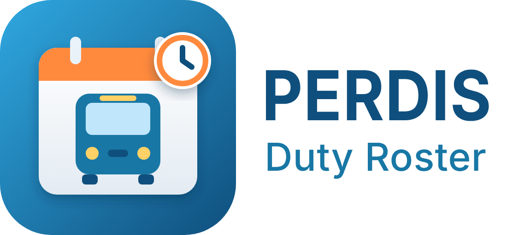
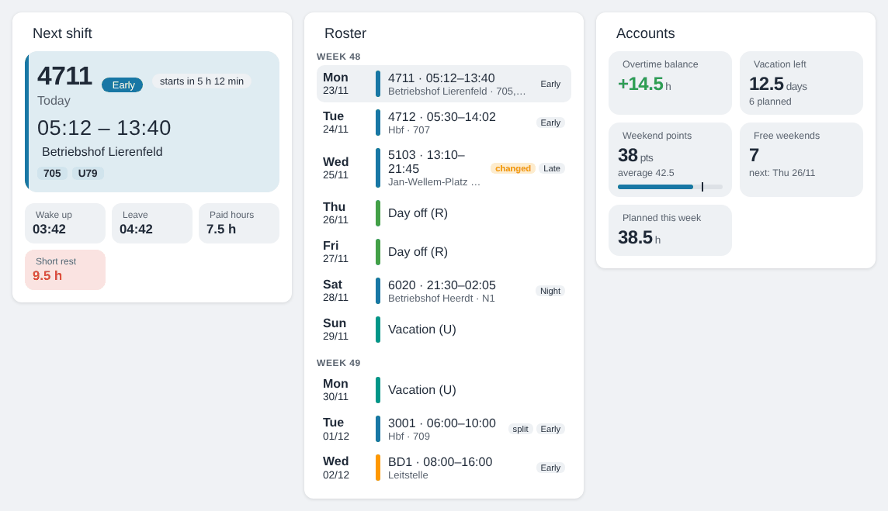
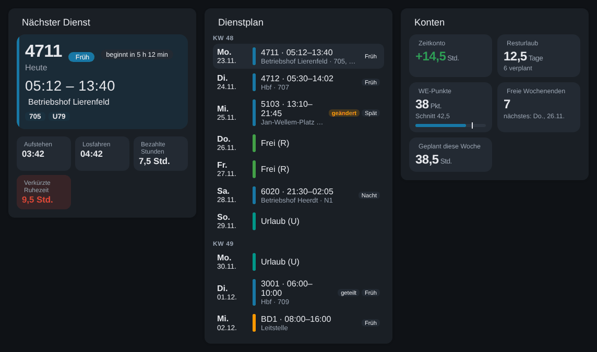

<!-- header:begin (generated from project metadata) -->
<h1 align="center">
  <picture>
    <source media="(prefers-color-scheme: dark)" srcset="https://raw.githubusercontent.com/seb5594/hass-perdis_roster-integration/main/custom_components/perdis_roster/brand/dark_logo@2x.png">
    
  </picture>
</h1>

<p align="center">
  <a href="https://my.home-assistant.io/redirect/hacs_repository/?owner=seb5594&amp;repository=hass-perdis_roster-integration&amp;category=integration"></a>
  <a href="https://github.com/seb5594/hass-perdis_roster-integration/actions/workflows/compat.yml"></a><br>
  <a href="https://github.com/seb5594/hass-perdis_roster-integration/releases"></a>
  <a href="https://github.com/seb5594/hass-perdis_roster-integration/releases"></a><br>
  <a href="https://github.com/seb5594/hass-perdis_roster-integration/stargazers"></a>
  <a href="https://github.com/seb5594/hass-perdis_roster-integration/forks"></a>
  <a href="https://github.com/seb5594/hass-perdis_roster-integration/actions/workflows/ci.yml"></a>
  
  <a href="https://github.com/seb5594/hass-perdis_roster-integration/issues"></a><br>
  <a href="https://paypal.me/seb5594"></a>
  <a href="https://buymeacoffee.com/seb5594"></a><br>
  <a href="https://github.com/seb5594/hass-perdis_roster-integration#license"></a>
</p>
<!-- header:end -->

**🇬🇧 English** · [🇩🇪 Deutsch](README.de.md)

Your duty roster from **MOBILE-PERDIS** in Home Assistant: the next shift with a countdown, the
time to get up, the rest before the next shift, free weekends, overtime, vacation and weekend
points. Changes to your roster show up as a notification, and automations can react to the
moment you have to get up or your shift starts.

PERDIS is the staff scheduling system many bus and tram companies in Germany, Austria and the
Netherlands use. Drivers see their roster in the **WebComm** portal in the browser or in the
**AppComm** app. This integration signs in to the same portal with your personal account.

> [!IMPORTANT]
> ⚠️ **This is an unofficial integration.** PERDIS is a product of INIT Mobility Software Solutions
> GmbH, which does not document the interfaces of WebComm or AppComm. The integration reads what
> the portal shows you after signing in, just like your browser. It is not affiliated with,
> endorsed or supported by INIT or by any transit operator. A portal update can change the pages;
> if something stops working, please [open an issue](https://github.com/seb5594/hass-perdis_roster-integration/issues).

<p align="center">
  
</p>

## 📑 Contents

- [✨ Features](#-features)
- [🚌 Transit companies](#-transit-companies)
- [📋 Requirements](#-requirements)
- [📦 Installation](#-installation)
- [⚙️ Setup](#️-setup)
- [🎛️ Options](#️-options)
- [📊 Entities](#-entities)
- [🃏 Dashboard cards](#-dashboard-cards)
- [⚡ Automations](#-automations)
- [🛠️ Services](#️-services)
- [📱 AppComm (Perdis mobile)](#-appcomm-perdis-mobile)
- [🧠 How it works](#-how-it-works)
- [🔒 Privacy](#-privacy)
- [🩺 Troubleshooting](#-troubleshooting)
- [🤝 Contributing](#-contributing)

## ✨ Features

- 🚌 **Pick your company from a list.** The setup dialog knows the portal address of several
  transit companies. Others are entered by hand; any address you copy from the browser works.
- 🕐 **Next shift at a glance**: duty number, start and end, reporting point, lines, a countdown
  and whether it is an early, day, late, night or split shift.
- ⏰ **Derived times**: when to get up and when to leave, worked out from your own lead time and
  way to work.
- 😴 **Rest check**: the rest between two shifts, with a warning when it is shorter than the
  minimum you set (11 hours by default, as in EU regulation 561/2006).
- 📅 **Days ahead**: today and tomorrow, the next day off, working days in a row, the next free
  weekend and how many free weekends the roster holds.
- ⏱️ **Planned hours** of the current week and month, counted per shift type.
- 💼 **Accounts**: overtime balance, target and actual time, vacation left (and left after the
  planned vacation), weekend points ("WE-Punkte") and how far you are from the group average.
- 🔔 **Roster changes** are detected on every refresh and reported as a notification, as an event
  and in a sensor that lists them.
- ⚡ **Device triggers** for the automation editor: *time to get up*, *time to leave*, *shift
  started*, *shift ended*, *free weekend started*, *roster changed* – announced to the second.
- 🗓️ **Calendar** with every shift and day off, for the calendar dashboard and calendar triggers.
- 🃏 **Three dashboard cards** that register themselves: next shift, roster and accounts.
- 💾 **Works through maintenance windows**: the last roster is cached and stays available while
  the portal is down.
- 🌍 **German and English** throughout: setup, entities, cards, notifications and calendar.
- 🪶 **Light**: no extra Python packages, one portal request sequence every 30 minutes, the cache is
  only written to disk when the roster really changed.

## 🚌 Transit companies

These companies run a public PERDIS WebComm portal. Each address was checked by opening its login
page in November 2026.

| Company | Region | Portal |
| --- | --- | --- |
| BOGESTRA | Bochum / Gelsenkirchen 🇩🇪 | `https://webcomm.bogestra.de/WebComm/` |
| DVG Duisburger Verkehrsgesellschaft | Duisburg 🇩🇪 | `https://perdis.dvv.de/WebComm/` |
| RegioBus Hannover | Region Hannover 🇩🇪 | `https://perdis.regiobus.de/WebComm/` |
| Rheinbahn | Düsseldorf 🇩🇪 | `https://webcom.rheinbahn.de/WebComm/` |
| rnv Rhein-Neckar-Verkehr | Mannheim / Heidelberg / Ludwigshafen 🇩🇪 | `https://fahrerauskunft.rnv-online.de/WebComm/` |
| Salzburg AG Verkehr | Salzburg 🇦🇹 | `https://perdis.salzburg-ag.at/WebComm/` |
| Transdev / Connexxion | Nederland 🇳🇱 | `https://diensten1.transdev.nl/WebComm/` |
| üstra Hannoversche Verkehrsbetriebe | Hannover 🇩🇪 | `https://wbc.uestra.de/WebComm/` |
| VGF Verkehrsgesellschaft Frankfurt | Frankfurt am Main 🇩🇪 | `https://perdis-info.vgf-ffm.de/WebComm/` |
| WSW mobil | Wuppertal 🇩🇪 | `https://service.wsw-online.de/WebComm/` ¹ |

¹ The portal answered "temporarily unavailable" on the day of the check.

🔎 **Your company is missing?** Choose *Enter the portal address myself* and paste the address you
open in the browser. A plain host name such as `perdis.example.org` works too; the integration
adds `/WebComm/` itself. If it works, please [tell me](https://github.com/seb5594/hass-perdis_roster-integration/issues)
so the company can be added to the list.

## 📋 Requirements

- 🏠 Home Assistant **2025.1** or newer.
- 👤 Your own account for the WebComm portal of your company (user name or personnel number and
  password), the same you use in the browser.
- 🌐 Home Assistant must be able to reach the portal. Some companies only allow access from their
  own network; then the integration can't reach it either.

## 📦 Installation

### HACS / Marketplace (recommended)

1. Click the **HACS · Marketplace** button at the top of this page, or open **HACS** (Home
   Assistant 2026.10 and older) or **Settings → Marketplace** (2026.11 and newer) and search for
   **Perdis Duty Roster**. If it is not found, add
   `https://github.com/seb5594/hass-perdis_roster-integration` as a custom repository of the
   category *Integration* first.
2. Download it and restart Home Assistant.

### Manual

1. Download `perdis.zip` from the [latest release](https://github.com/seb5594/hass-perdis_roster-integration/releases/latest).
2. Unpack it into `config/custom_components/perdis_roster/`, so that `manifest.json` ends up in that folder.
3. Restart Home Assistant.

## ⚙️ Setup

1. Go to **Settings → Devices & services → Add integration** and search for **Perdis Duty Roster**.
2. Choose how to find your portal:
   - 🚌 **Pick my transit company from the list**, or
   - ✍️ **Enter the portal address myself** – paste the address from the browser. Leave *Kind of
     portal* on **WebComm** unless your company gave you an AppComm service address.
3. Enter your **user name / personnel number** and **password**. The dialog signs in once to check
   them, then the roster appears within a few seconds.

Several accounts (for example of a couple who both drive) can be added side by side; each gets
its own device with its own entities.

When you change your password in the portal, Home Assistant shows a **repair notice** and asks
for the new one – no need to remove the integration.

## 🎛️ Options

**Settings → Devices & services → Perdis Duty Roster → Configure**

| Option | Default | What it does |
| --- | --- | --- |
| ⏰ Wake up before the shift | 90 min | Gives the wake-up time and its trigger |
| 🚗 Way to work | 30 min | Gives the leave-home time and its trigger |
| 😴 Minimum rest between shifts | 11 h | A shorter rest switches on *Short rest* |
| 🔔 Notify me about roster changes | on | Shows a notification for every change |
| 🔄 Check the portal every | 30 min | How often the portal is asked (10–360 min) |
| ➡️ Days ahead | 42 | How far ahead the roster is read |
| ⬅️ Days to keep in the past | 7 | Past days that stay in the calendar |

The folded section **Pages of the portal (advanced)** is only needed for unusual portals. The
integration finds the roster, account and weekend points pages in the portal menu by itself; if
one is not found (see [Troubleshooting](#-troubleshooting)), enter its path here, e.g.
`Dienstplan.aspx`.

## 📊 Entities

> [!NOTE]
> Only the sensors a portal can actually fill are created. At setup the integration probes which
> pages your portal serves and which account values it returns; a portal that does not expose, for
> example, weekend points simply shows no weekend-point sensors instead of a row of "unknown". Add
> the integration again (reload) after your operator unlocks a new feature.

All entities belong to one device per account. The entity IDs below assume an account named
*Rheinbahn (4711)* and Home Assistant in English; yours start with the name of your account.

### 🕐 Next shift

| Entity | Example | Notes |
| --- | --- | --- |
| `sensor.…_next_shift` | `4711` | Running or next shift. Attributes: date, start, end, places, lines, hours, category, minutes until start/end, wake-up and leave-home time, rest before |
| `sensor.…_next_shift_start` / `_end` | timestamp | Show as relative time ("in 5 hours") |
| `sensor.…_next_shift_location` | `Betriebshof Lierenfeld` | Reporting point |
| `sensor.…_next_shift_type` | `early` | early, day, late, night or split |
| `sensor.…_wake_up_time` | timestamp | Shift start minus your wake-up lead |
| `sensor.…_leave_home` | timestamp | Shift start minus your way to work |
| `sensor.…_rest_before_next_shift` | `9.5 h` | End of the previous shift until the start of the next |

### 📅 Days

| Entity | Example | Notes |
| --- | --- | --- |
| `sensor.…_today` / `_tomorrow` | `work` | Duty, reserve, training, day off, vacation, time off in lieu, sick leave |
| `sensor.…_next_day_off` | `2026-11-26` | Today when you are off |
| `sensor.…_days_until_day_off` | `3 d` | |
| `sensor.…_working_days_in_a_row` | `3 d` | From today until the next day off |
| `sensor.…_next_free_weekend` | `2026-11-28` | Saturday of the next weekend with both days off |
| `sensor.…_free_weekends_ahead` | `2` | Free weekends in the roster you can see |
| `sensor.…_planned_hours_this_week` / `_month` | `38.5 h` | Attributes count the duties per type and shift category |

### 💼 Accounts

| Entity | Example | Notes |
| --- | --- | --- |
| `sensor.…_overtime_balance` | `14.5 h` | Attributes: target and actual hours, every balance the portal shows |
| `sensor.…_vacation_left` | `12.5 d` | Attributes: planned days, entitlement, days left after the planned vacation |
| `sensor.…_weekend_points` | `38.5 pts` | Attributes: group average, recent entries |
| `sensor.…_weekend_points_vs_average` | `-3.5 pts` | Negative: fewer points than your group |
| `sensor.…_free_weekends_this_year` | `7` | As counted by the portal |

### 🔎 Yes / no

| Entity | On when |
| --- | --- |
| `binary_sensor.…_on_duty` | A shift is running |
| `binary_sensor.…_day_off_today` / `_tomorrow` | The day is off, vacation or time off in lieu |
| `binary_sensor.…_split_shift_today` | Today's duty has a long break in between |
| `binary_sensor.…_short_rest` | The rest before the next shift is shorter than your minimum |
| `binary_sensor.…_portal` | The last refresh reached the portal (diagnostic) |

### 🗂️ Lists and calendar

| Entity | Notes |
| --- | --- |
| `sensor.…_roster` | Number of days in the next six weeks; the `days` attribute feeds the roster card |
| `sensor.…_roster_changes` | Changes of the last 14 days, each with a readable summary |
| `sensor.…_last_refresh` | Last successful refresh, last error and the pages found (diagnostic) |
| `calendar.…_duties` | Shifts as timed entries, days off and absences as all-day entries |

Long lists are kept out of the recorder database, so the history stays small.

## 🃏 Dashboard cards

The cards are part of the integration and register themselves – there is **no resource to add**.
Edit a dashboard, click **Add card** and search for **Perdis**. Every card has a **visual editor**
with grouped sections (*Content*, *Appearance*, *Behaviour*), so you never need to write YAML.
Without settings a card shows the first Perdis account.

| Card | Shows |
| --- | --- |
| 🕐 `perdis-shift-card` | The next shift: duty, shift type, countdown, times, reporting point, lines, wake-up and leave-home time, rest warning, progress while it runs |
| 📋 `perdis-roster-card` | The coming days grouped by calendar week, colored by type, with changed days marked |
| 💼 `perdis-accounts-card` | Overtime, vacation, weekend points against the average, free weekends and the planned hours of the week or month |

Everything can be tuned in the editor (or in YAML). Options shared by all cards:

| Option | Default | What it does |
| --- | --- | --- |
| `device_id` | first account | Which Perdis account the card shows |
| `title` | card name | A custom header title |
| `icon` | `mdi:bus-clock` | A custom header icon |
| `show_header` | `true` | Hide the header for a bare card |
| `accent` | by shift type | An accent colour (RGB), overriding the type colour |
| `tap_action` | more-info | A full Lovelace action (`more-info`, `navigate`, `url`, `perform-action`, `none`) |

<details>
<summary>🕐 Shift card options</summary>

| Option | Default | What it does |
| --- | --- | --- |
| `show_facts` | all | Which fact tiles to show: `wake_up`, `leave_home`, `paid`, `rest` |
| `show_location` | `true` | Show the reporting point |
| `show_lines` | `true` | Show the line badges |
| `show_countdown` | `true` | Show the countdown pill |
| `show_progress` | `true` | Show the progress bar while on duty |

```yaml
type: custom:perdis-shift-card
accent: [123, 97, 255]
show_facts: [wake_up, rest]
show_lines: false
```

</details>

<details>
<summary>📋 Roster card options</summary>

| Option | Default | What it does |
| --- | --- | --- |
| `days` | `14` | How many days to list (3–42) |
| `hide_types` | – | Day types to hide, e.g. `[free, vacation]` |
| `show_days_off` | `true` | Shortcut: `false` hides days off, vacation and time off |
| `group_by_week` | `true` | Group the days under calendar week headers |
| `compact` | `false` | Tighter rows without the second line |
| `show_location` / `show_lines` / `show_tags` | `true` | Show the reporting point, the lines, the tags |
| `highlight_today` | `true` | Highlight today's row |

```yaml
type: custom:perdis-roster-card
days: 21
hide_types: [free, vacation, compensation]
compact: true
group_by_week: false
```

</details>

<details>
<summary>💼 Accounts card options</summary>

| Option | Default | What it does |
| --- | --- | --- |
| `show_tiles` | 5 tiles | Which tiles and in which order: `overtime`, `vacation`, `weekend_points`, `free_weekends`, `planned_week`, `planned_month` |
| `columns` | `0` (auto) | Fix the number of columns (1–4) |

```yaml
type: custom:perdis-accounts-card
show_tiles: [overtime, weekend_points, planned_month]
columns: 3
device_id: 0123456789abcdef0123456789abcdef  # optional, for a second account
```

</details>

<p align="center">
  
</p>

## ⚡ Automations

### Device triggers

In the automation editor choose **Device → your Perdis account**. The triggers fire at the exact
second; nothing is polled:

| Trigger | When |
| --- | --- |
| ⏰ Time to get up | Shift start minus the wake-up lead |
| 🚗 Time to leave | Shift start minus the way to work |
| ▶️ Shift started / ⏹️ Shift ended | At the start and end of every shift |
| 🎉 Free weekend started | Saturday 00:00 of a weekend with both days off |
| 🔔 Roster changed | When a refresh finds a change |

### Events

Every moment is also an event on the bus, `perdis_roster_event`, with `type` (the trigger names above:
`wake_up`, `leave_home`, `shift_started`, `shift_ended`, `free_weekend_started`,
`schedule_changed`), `device_id`, `entry_id` and the `duty`. Roster changes add `changes` and a
readable `summary`.

<details>
<summary>⏰ Wake-up light 10 minutes before the alarm</summary>

```yaml
alias: Wake-up light before an early shift
triggers:
  - trigger: template
    value_template: >
      {{ states('sensor.rheinbahn_4711_wake_up_time') not in ['unknown', 'unavailable']
         and now() >= states('sensor.rheinbahn_4711_wake_up_time') | as_datetime - timedelta(minutes=10) }}
conditions:
  - condition: state
    entity_id: sensor.rheinbahn_4711_next_shift_type
    state: early
actions:
  - action: light.turn_on
    target:
      entity_id: light.bedroom
    data:
      brightness_pct: 30
      transition: 600
```

</details>

<details>
<summary>📱 Push message when the roster changes</summary>

```yaml
alias: Tell me about roster changes
triggers:
  - trigger: event
    event_type: perdis_roster_event
    event_data:
      type: schedule_changed
actions:
  - action: notify.mobile_app_my_phone
    data:
      title: Roster changed
      message: "{{ trigger.event.data.summary | join('\n') }}"
```

</details>

<details>
<summary>🌡️ Heat the flat up before the end of the shift</summary>

```yaml
alias: Warm flat after the shift
triggers:
  - trigger: template
    value_template: >
      {{ is_state('binary_sensor.rheinbahn_4711_on_duty', 'on')
         and now() >= states('sensor.rheinbahn_4711_next_shift_end') | as_datetime - timedelta(minutes=45) }}
actions:
  - action: climate.set_preset_mode
    target:
      entity_id: climate.living_room
    data:
      preset_mode: comfort
```

</details>

<details>
<summary>😴 Warn the evening before a short rest</summary>

```yaml
alias: Short rest ahead
triggers:
  - trigger: state
    entity_id: binary_sensor.rheinbahn_4711_short_rest
    to: "on"
actions:
  - action: notify.mobile_app_my_phone
    data:
      message: >
        Only {{ states('sensor.rheinbahn_4711_rest_before_next_shift') }} h of rest before
        duty {{ states('sensor.rheinbahn_4711_next_shift') }}. Go to bed early!
```

</details>

## 🛠️ Services

| Service | What it does |
| --- | --- |
| `perdis_roster.refresh` | Asks the portal now instead of waiting for the next check. Optional `config_entry_id` |
| `perdis_roster.get_duties` | Returns the duties between `start_date` and `end_date` (default: two weeks from today) and the planned hours, for scripts and notifications |

```yaml
action: perdis_roster.get_duties
data:
  start_date: "2026-11-23"
  end_date: "2026-11-29"
response_variable: roster
```

## 📱 AppComm (Perdis mobile)

Besides WebComm, PERDIS offers the **AppComm** app. Behind it runs a JSON service that each
company has to switch on; INIT does not publish its interface. The integration therefore treats
AppComm as **experimental**:

- Choose *Enter the portal address myself* and **AppComm service (experimental)**.
- The client signs in with a JSON login and accepts a token (sent as `Authorization: Bearer`) or a
  session cookie.
- The paths default to `api/auth/login`, `api/roster`, `api/accounts` and `api/weekend-points`.
  If your company's service uses others, enter them under **Configure → Pages of the portal
  (advanced)**.
- The answers are read flexibly: the list of days is searched anywhere in the answer, and the
  usual field names (`date`/`datum`, `start`/`beginn`, `dutyNumber`/`dienstNr`, …) are understood.

If you know the real endpoints of an AppComm service, an
[issue](https://github.com/seb5594/hass-perdis_roster-integration/issues) with the paths (never your
password or token) helps everyone.

## 🧠 How it works

```text
 WebComm portal ──► client ──► parser ──► snapshot ──► cache (.storage)
   (ASP.NET)        sign in,    tables      duties,        │
                    find pages, by header   accounts,      ▼
                    next month  text        points     change detection ──► notification, event
                                                           │
                                     every minute ◄────────┴──► insights ──► sensors, cards
                                     (no network)                  timers ──► device triggers
```

- **Signing in** works like a browser: the client follows ASP.NET's cookie check, fills the login
  form with its hidden view state and keeps the session cookie. An expired session is renewed
  automatically.
- **Finding the pages**: menus differ per company, so the roster, account and weekend points pages
  are found by the words in the menu links (German, English and Dutch).
- **Reading tables**: columns are recognised by their header text ("Beginn", "Dienstbeginn",
  "Aanvang", …), not by position. Tables without a header are read by what the cells contain.
  Times past midnight such as `25:45` are handled, and so are split shifts.
- **Next month**: when the roster page ends before the period you want, the client presses the
  page's "next" button (up to three times).
- **Insights** are worked out once a minute from the cached roster, without network traffic.
- **Moments** (wake up, shift start, …) are timers set after every refresh, so automations fire on
  the second.

## 🔒 Privacy

- 🔑 Your user name and password are stored in Home Assistant's config entry and only sent to the
  portal address you chose.
- 🏠 The roster stays in your Home Assistant; nothing is sent anywhere else.
- 🧾 The diagnostics download leaves out user name, password, your name and the raw account labels.

## 🩺 Troubleshooting

| Problem | What to do |
| --- | --- |
| *The portal did not accept the user name or password* | Sign in in the browser with the same data. Some companies lock an account after several failed attempts. |
| *The portal could not be reached* | Open the address in a browser on the same network as Home Assistant. Some portals are only reachable from the company network. |
| *Not like a Perdis portal* | Check the address; it must end in the folder of the portal (e.g. `/WebComm/`). |
| Roster stays empty | Open **Last refresh** (diagnostic) and look at the `pages` attribute. If `roster` is missing, enter the path of the roster page in the advanced options. |
| Accounts or weekend points are unknown | Not every company shows them. If they are in the portal under a different name, please open an issue with the label text. |

Download the **diagnostics** (device page → ⋮ → *Download diagnostics*) for an issue. For more
detail, enable debug logging:

```yaml
logger:
  logs:
    custom_components.perdis_roster: debug
```

## 🤝 Contributing

- 🚌 **A company is missing?** Open an issue with the company name and the portal address.
- 🧩 **A page is not understood?** Save it in the browser (*Save page as… → HTML only*), replace
  your name, personnel number and anything personal with dummy values and attach it to an issue.
  The parsers are tested against such pages in `.github/tests/fixtures/`.
- 🧪 Tests: `python -m unittest discover -s .github/tests` runs without Home Assistant; the tests in
  `.github/ha_tests/` run inside a real Home Assistant core against a fake WebComm portal.

## ⚖️ Disclaimer

PERDIS, MOBILE-PERDIS, WebComm and AppComm are products and possibly trademarks of INIT Mobility
Software Solutions GmbH. Company names belong to their owners and are only used to point to their
portals. This project is not affiliated with any of them. Use it with your own account only and
follow the rules of your employer.

<!-- support:begin (generated, shared text) -->
## Say thanks

All my projects are built in my spare time, just for the fun of it. Still, they take a lot of time and care, and many of the smart home gadgets I buy end up here because I want to make them cloud-free and smart-home ready. Every bit of support means a lot to me.

If my work helped you or turned out to be useful, show your appreciation with a hot drink for my next sleepless night.

[](https://paypal.me/seb5594) [](https://buymeacoffee.com/seb5594)
<!-- support:end -->

<!-- license:begin (generated from the license file) -->
## License

[](LICENSE)

Published under the [MIT License](LICENSE).
<!-- license:end -->
